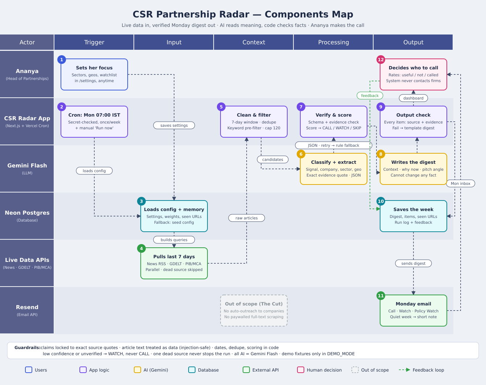

# CSR Partnership Radar

**A weekly AI digest of CSR partnership opportunities, built for a Pune education and skilling NGO.**
Every Monday at 07:00 IST it scans the last 7 days of live Indian news. It finds companies that are **seeking NGO partners**, **launching new CSR programmes**, **raising CSR budgets**, or affected by **CSR policy changes** in education, skill development, digital literacy and youth employment. It then sends Ananya (Head of Corporate Partnerships) a short email built around one decision: *is this worth a call this week?*

- **Live app:** https://csr-partnership-radar.vercel.app
- **Repository:** https://github.com/Aritra11022003/csr-partnership-radar
- **Components map:** [`COMPONENTS_MAP.md`](COMPONENTS_MAP.md) · [`docs/components_map.svg`](docs/components_map.svg)
- **AI:** Google **Gemini Flash** only (`@google/genai`). No other LLM SDK is used (enforced in CI).



---

## Why it exists

Ananya hears about roughly one in three relevant CSR announcements, usually late. Last year a company searched for implementation partners for three months before her team knew the programme existed. The radar closes that gap. It reads live sources every week and filters them down to a few decision-ready items. Each item has a verbatim evidence quote, a source link, a "why now" line, and a CALL / WATCH verdict.

## What one item looks like

> 🟢 **CALL · score 90**
> **Vardhan Auto Components seeks NGO partners for Pune youth skilling**
> Skill Development · Pune · Partner search · ₹6 crore
> Vardhan Auto Components is seeking implementation partners for a ₹6 crore programme to train 3,000 school dropouts in Chakan and Pimpri. This matches our dropout-skilling work in our home district.
> **Why now:** Proposals are due by month-end and partners are not yet chosen.
> **Angle:** Lead with our placement outcomes for first-generation job seekers in Pimpri-Chinchwad.
> *"…seeking implementation partners for a ₹6 crore programme to train 3,000 school dropouts…"*
> example-news.test ↗ · 10 Oct 2026 · 👍 👎 📞 Called

*(This example comes from a DEMO fixture with a fictional company.)*

---

## Architecture

```
Vercel Cron (Mon 01:30 UTC = 07:00 IST) ─┐        ┌─ "Run now" (ADMIN_TOKEN)
                                         ▼        ▼
                                   /api/run  (maxDuration 300 s)
 ┌──────────────────────────────────────────────────────────────────────────────┐
 │ 3  load config + memory   (Neon Postgres → fallback seed/*.json)            │
 │ 4  fetch live, parallel   Google News RSS · GDELT · India CSR · CSR Journal │
 │                           PIB · NewsAPI(opt)   — allSettled, 10 s timeouts   │
 │ 5  clean (code)           normalise → IST 7-day window → dedupe → seen-URLs  │
 │                           → keyword pre-filter + India check → cap 120       │
 │                           → resolve Google links → public meta description   │
 │ 6  classify (Gemini)      batches of 10, JSON schema, zod, retry, rules      │
 │ 7  verify + score (code)  exact-quote evidence, geo tiers, weights, caps     │
 │ 8  write (Gemini)         headline · context · why now · angle              │
 │ 9  output check (code)    reject invented names/numbers → template          │
 │ 10 store                  digest, seen URLs (30 d), run log                 │
 │ 11 email (Resend)         once per ISO week; quiet week → short note        │
 └──────────────────────────────────────────────────────────────────────────────┘
        ▼                                   ▼
   Dashboard (/ , /digest/[date])     Ananya's inbox → 👍 👎 📞 → next week's ranking
```

The LLM does two things only: **read meaning** (classify and extract) and **write prose**. Dates, dedupe, relevance gates, evidence checks, scoring, verdicts, link checks and the final facts are all deterministic code.

### Stack
Next.js 15 (App Router, TypeScript) on Vercel · `@google/genai` (Gemini Flash, JSON mode + `responseSchema`) · `zod` · `rss-parser` · Neon Postgres (serverless driver) · Resend · Vitest.

### Repository layout
```
app/
  page.tsx                 latest digest + "Run now"
  digest/ , digest/[date]  archive + past digests
  settings/                sectors, geos, watchlist, weights, recipients (saved to Postgres)
  how-it-works/            map, pipeline, guardrails
  api/run                  cron (CRON_SECRET) + manual (ADMIN_TOKEN)
  api/feedback             HMAC-signed 👍/👎/📞 links
  api/settings, digests, health
lib/
  run.ts                   the pipeline orchestrator
  sources/                 queries.ts, fetchers.ts, demo.ts
  pipeline/                clean.ts, injection.ts, classify.ts, rules.ts, score.ts, digest.ts
  email/                   render.ts (HTML + text), send.ts (Resend)
  gemini.ts, config.ts, store.ts, auth.ts, util.ts, types.ts
prompts/                   classify.md, digest.md, guardrails.md (loaded at run time)
seed/                      config.json, watchlist_companies.json, sample_articles.json (DEMO only)
tests/                     guardrail tests (G1–G23)
scripts/                   run-local, fetch-live, check-no-anthropic, check-secrets
```

---

## Scoring (deterministic)

`score = signal + sector + geo tier + recency + watchlist + source credibility − unverified penalty ± feedback`

| Component | Default |
|---|---|
| Signal | PARTNER_SEARCH 40 · NEW_INITIATIVE 28 · ALLOCATION_UP 22 · POLICY 15 |
| Sector | primary 20 · secondary 10 |
| Geo tier | Pune 20 · Maharashtra 14 · West India 8 · Pan-India 6 · other/unknown 2 |
| Recency | 0–2 d 10 · 3–5 d 6 · 6–7 d 3 |
| Watchlist company | +5 |
| Source credibility | high +5 · medium +2 |
| Evidence not verbatim in source | −25 |
| Feedback from Ananya | bounded ±5 per company |

**Verdict:** CALL ≥ 65 · WATCH ≥ 40 · else SKIP. **Hard rules** (applied after the score): confidence < 0.6, unverified evidence, or a prompt-injection flag means the item is **never CALL**. A verified PARTNER_SEARCH in a focus sector is **always at least WATCH**. POLICY items go to *Policy Watch* whatever their score. Everything is editable in `/settings`.

---

## Guardrails → enforcement → test

| # | Guardrail | Enforced in | Test |
|---|---|---|---|
| G1 | No fabricated facts | `digest.ts` `checkText` + code re-attaches facts | `tests/digest.test.ts` "injected fake company → template" |
| G2 | Evidence required | `score.ts` `verifyEvidence` (−25, never CALL) | `classify.test.ts` "paraphrased quote downgraded" |
| G3 | No guessed numbers | prompt rule + `checkText` amount/number check | `fx-12 → amount_inr_crore === null`; unstated ₹ rejected |
| G4 | Partner-search precision | prompt rule + `PARTNER_SEARCH_RE` code guard | `fx-10` is not PARTNER_SEARCH even if the model says so |
| G5 | Every item has a source | `normalize` + output filter | "drops items without a valid http(s) URL" |
| G6 | Prompt injection | JSON-wrapped data, regex pre-scan, `injection_flag` → cap WATCH | `fx-09` not CALL + flagged, even with an "obedient" mock model |
| G7 | Secrets safe | server-only env, `redact()`, booleans-only `/api/health` | `api.test.ts` + `scripts/check-secrets.mjs` greps the build |
| G8 | Protected endpoints | `lib/auth.ts` (timing-safe) | `/api/run`, `/api/settings` without a token → 401 |
| G9 | Gemini only | `scripts/check-no-anthropic.mjs` in CI | `pipeline.test.ts` |
| G10 | 7-day window (IST) | `filterByDate` | `fx-08` dropped; IST midnight boundary |
| G11 | Dedupe | canonical URL · Jaccard ≥ 0.8 · company + signal · seen URLs 30 d | `fx-06` merged into `fx-01` with both sources |
| G12 | Relevance | pre-filter + India check + sector gate in code | `fx-05`, `fx-07`, `fx-11` never surface |
| G13 | Schema validity | zod → retry with hint → rules | malformed JSON / missing ids / invented ids |
| G14 | Confidence gate | `scoreItem` | 0.59 → WATCH, 0.60 → CALL |
| G15 | One source failing ≠ failed run | `Promise.allSettled`, per-source status on dashboard | live run (GDELT 429 handled) |
| G16 | Quiet week | `quiet` digest + short email | "no strong signals" with scanned count |
| G17 | Cost cap | ≤ 120 items, batches of 10, top pre-filter scores kept | `clean.test.ts` cap test |
| G18 | Time limit | `maxDuration = 300`, parallel fetches, 10 s timeouts, ≤ 4 LLM batches in flight | live run ≈ 35–60 s |
| G19 | Idempotent | ISO-week run lock + once-per-week email key | second cron firing skipped; one Resend call |
| G20 | Human decides | email goes only to configured recipients | Resend payload test |
| G21 | No personal data | company-level only; `checkText` rejects emails/phones | `digest.test.ts` |
| G22 | Transparency | source, date, verbatim quote, AI disclaimer on every item | email/dashboard templates |
| G23 | Demo separation | fixtures only when `DEMO_MODE=true`, tagged DEMO, filtered otherwise | `pipeline.test.ts` |

```
npm test               # 58 tests
npm run typecheck
npm run check:no-anthropic
```

---

## Run it locally

```bash
npm install
cp .env.example .env.local      # add GEMINI_API_KEY at minimum
npm run fetch:live              # live counts per source and per query
npm run run:local               # full live pipeline → out/digest.json, out/email.html, out/scored.json
npm run run:local -- --demo     # live + DEMO fixtures
npm run dev                     # dashboard on http://localhost:3000
```
Without `DATABASE_URL` the app uses a local JSON file store in `.data/`. Without `GEMINI_API_KEY` the conservative rule-based classifier runs (it never produces CALL) and the template writer is used.

## Deploy (Vercel)

1. Import the GitHub repo in Vercel (framework: Next.js).
2. Set `DATABASE_URL` to a Neon Postgres connection string. The app creates its own `csr_radar` schema on first use, so it can share a database safely.
3. Set env vars: `GEMINI_API_KEY`, `GEMINI_MODEL` (e.g. `gemini-3.8-flash`), `CRON_SECRET`, `ADMIN_TOKEN`, `RESEND_API_KEY`, `DIGEST_FROM_EMAIL`, `DIGEST_TO_EMAILS`, optional `APP_BASE_URL`, `NEWSAPI_KEY`.
4. Deploy. `vercel.json` registers the cron `30 1 * * 1` (07:00 IST Monday). Vercel sends `Authorization: Bearer $CRON_SECRET`.
5. Smoke test: open `/api/health`, then press **Run now** on `/` (enter `ADMIN_TOKEN`).
6. Resend: with the default `onboarding@resend.dev` sender, Resend only delivers to the account owner's address. To email Ananya, verify a domain and set `DIGEST_FROM_EMAIL`.

## Configure

Everything Ananya would want to change is in **`/settings`**, saved to Postgres and used by the next run:
sectors and keywords (add, disable, edit) · geographies, tiers and aliases · watchlist · signal trigger phrases · signal weights · thresholds · penalty · recipients · look-back window. The settings page also lists the exact search queries the next run will use.

---

## Known limits and honest notes

- **Snippets are short.** Google News RSS only gives headlines. The radar resolves each Google link to the publisher and uses the page's public meta description. It does not scrape paywalled full text, so some items are judged on the headline plus a single summary sentence. Low-information items get lower confidence and therefore can't be CALL.
- **GDELT rate-limits aggressively** (1 request / 5 s per IP, and shared cloud IPs are often throttled). It is treated as a bonus source. When it returns 429 the run carries on and the dashboard shows the failure.
- **PIB's RSS** carries no publish date and only lists the current day's releases. Items are dated at fetch time and must also match CSR terms. Policy coverage relies mainly on Google News `site:pib.gov.in` / `site:mca.gov.in` queries.
- **The output checker is deliberately strict.** If Gemini adds a proper noun or number that isn't in the source, that item falls back to a plainer template. Accuracy beats polish.
- **Company names come from the model** (verified against the source text only through the evidence quote). Same-company dedupe uses a normalised two-word key, so rare collisions are possible.
- **Feedback learning** is a small, bounded per-company nudge, not a trained model.
- **Gemini free tier is about 20 requests per model per day.** A normal run uses about 6 (≈5 classify batches + 1 writer call). If a model's daily quota runs out (or it returns 404 or 503), the client moves to the next **Flash** model (`3.8-flash → 3.6-flash → 3.5-flash → flash-latest → 3.5-flash-lite`). At most 3 calls run at once, and per-minute 429s wait for the advertised delay. If every Flash model is exhausted, the rule-based classifier and the template writer still produce a (more conservative) digest.
- **Resend sandbox sender** only delivers to the account owner until a domain is verified.

## Ethics
The radar **informs a human, never acts**. It sends no outreach, collects no personal contact data, and quotes and links every claim. The footer of every email says the content is AI-generated and asks the reader to verify before outreach.
